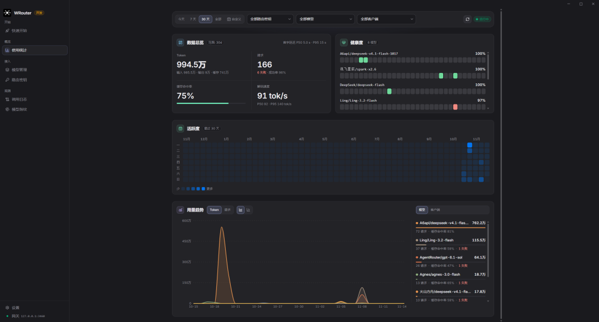

# WROUTER

**A local AI gateway for Claude Code, Codex, OpenCode and other coding clients.** One endpoint in front of many providers, with routing, failover and usage analytics — and every byte of your data staying on your own machine.

[](LICENSE)
[](#system-requirements)
[](https://github.com/iwudun/WRouter/releases)

**English** | [简体中文](README_ZH.md)

[Download](#download--install) · [Quick Start](#quick-start) · [Features](#features) · [FAQ](#faq) · [Documentation](#documentation)

---

## WHY WROUTER?

Every coding client speaks one protocol and keeps its provider config in its own format. Run two clients against three providers and you end up with four config files that drift apart, no visibility into what you spent, and no idea whether a cheap channel is actually serving the model you paid for.

WRouter sits between the client and the upstream: a single local endpoint that speaks OpenAI, Anthropic and Gemini protocols, routes per request, fails over between providers, and records what actually happened.

- **One endpoint, three protocols** — `POST /v1/chat/completions`, `/v1/messages`, `/v1/responses`, `/v1/embeddings`, `/v1beta/models/{action}`.
- **Routing you can see** — model groups, priority and sticky selection, automatic failover, every decision written to the request log.
- **Provider management** — add, probe and switch providers from the UI; API keys live in SQLite and are only ever returned masked.
- **Usage that adds up** — token totals, decode/output throughput, health per model, cost savings against your baseline.
- **Local-first** — no account, no telemetry, no cloud. The gateway only listens on loopback.
- **Two shapes** — a Windows desktop shell (Tauri v2, ~15 MB installer) or a headless Linux backend (static musl binary + systemd user unit).

## SCREENSHOTS



<sub>Usage dashboard — token totals, per-model health, activity heatmap and cost trend.</sub>

## DOWNLOAD & INSTALL

### SYSTEM REQUIREMENTS

| Platform | Form | Notes |
| --- | --- | --- |
| Windows 10+ | Desktop shell (Tauri v2) | NSIS installer, WebView2 required (bundled on Win 11, auto-installed on Win 10) |
| Linux x86_64 | Headless backend | RPM, glibc 2.28+ baseline, systemd user unit, no GUI dependencies |
| macOS | **Not supported** | Desktop shell targets Windows only; no build is produced or tested |

### WINDOWS

Download `WRouter_<version>_x64-setup.exe` from [Releases](https://github.com/iwudun/WRouter/releases) and run it. The installer is unsigned; SmartScreen may ask for confirmation.

Data lives in `%APPDATA%\WRouter\data` and survives uninstall.

### LINUX

```bash
sudo rpm -i WRouter-<version>.x86_64.rpm
systemctl --user enable --now wrouter
```

Then open `http://127.0.0.1:3462/` in a browser. Data lives in `~/.wrouter/`.

## QUICK START

1. **Open the dashboard** — `http://127.0.0.1:3462/` (Windows: launched by the desktop shell).
2. **Add a provider** — Providers → New: base URL, API key, model list. Use *Probe* to check reachability before saving.
3. **Point your client at the gateway.**

   ```bash
   # Claude Code
   export ANTHROPIC_BASE_URL=http://127.0.0.1:3460

   # Codex / any OpenAI-compatible client
   export OPENAI_BASE_URL=http://127.0.0.1:3460/v1
   ```

4. **Watch it work** — Usage shows token totals and cost savings, Logs shows the routing decision for every request.

Ports: gateway `3460`, management `3462`. Override with `WROUTER_GATEWAY_PORT` / `WROUTER_WEB_PORT`.

## FEATURES

### ROUTING & PROVIDERS

- **Model groups** — several providers behind one model name, with priority, sticky selection and automatic failover on 5xx, timeout or empty stream.
- **Protocol translation** — OpenAI ⇄ Anthropic ⇄ Gemini, including streaming, tool calls and reasoning blocks.
- **Health probes** — a five-gate reachability check that separates "key invalid" from "endpoint blocked" from "model missing".
- **Client fingerprint presets** — optional headers and body shape so upstreams that gate on client identity accept the request.

### OBSERVABILITY

- **Request logs** — protocol, provider, model, status, latency, token accounting, failover chain.
- **Usage & cost** — daily buckets, decode/output throughput reported separately, savings against a configurable baseline, activity heatmap.
- **Per-model health** — success rate and latency per provider/model, so a degrading channel shows up before you notice it in your editor.

### MODEL FINGERPRINT (OPTIONAL)

- Probe a provider with a fixed random-number challenge and compare the response distribution against a library you build yourself.
- Useful when you buy a cheap channel claiming to serve a specific model; skip it if you only use official endpoints.

### SECURITY & DATA

- **Loopback only** — the gateway binds `127.0.0.1`.
- **Keys stay local** — SQLite `secrets` table, masked in every API response; three-state write semantics (empty/missing/`***` keeps the key, explicit `null` clears it).
- **Management API auth** — `x-wrouter-web-auth` header, token at `<data dir>/auth_token`; `/api/v1/health` and `/api/v1/capabilities` are public.
- **Back up before upgrading** — only the latest data format is supported. Old config keys are not read and SQLite rows are not migrated.

## BUILD FROM SOURCE

Requires Node.js ≥ 20 (22 recommended) and Rust 1.98 (pinned in `backend/rust-toolchain.toml`). Windows additionally needs VS Build Tools 2022 + `x86_64-pc-windows-msvc`, plus WinLibs MinGW for the GNU-host backend workspace; Docker is only needed for Linux packaging.

```bash
npm run setup     # install deps and build the backend binary (idempotent)
npm run dev       # Vite dev server + Tauri desktop shell
npm run build:win # Windows installer (NSIS)
npm run build:rpm # Linux RPM, built inside Docker
```

Gates:

```bash
bash scripts/check-rust.sh              # purity + fmt + clippy + tests
cd frontend && npm run typecheck && npm test
node scripts/validate-capabilities.mjs  # management RPC contract
npm run version:check                   # version consistency
```

`cargo fmt --check`, `cargo clippy -D warnings` and `typecheck:unused` already report pre-existing findings on `master`; judge your change incrementally and never reformat the whole tree. Details in [docs/reference/05](docs/reference/05-开发指南.md).

## DOCUMENTATION

Reference docs are written in Chinese for now.

- [01 Overview](docs/reference/01-项目概览.md) · [02 Architecture](docs/reference/02-架构设计.md) · [03 Protocols & Routing](docs/reference/03-网关协议与路由.md) · [04 Features & Compatibility](docs/reference/04-功能与兼容性.md) · [05 Development](docs/reference/05-开发指南.md) · [06 Build & Release](docs/reference/06-构建与发布.md) · [07 FAQ & Limitations](docs/reference/07-FAQ与已知限制.md)
- `docs/design/` — module-level design notes
- `docs/LESSONS.md` — engineering pitfalls and their evidence

## FAQ

**Does it upload anything?**
No. The gateway binds loopback, writes to local SQLite, and has no telemetry or account system.

**How do I upgrade?**
Download the new installer from [Releases](https://github.com/iwudun/WRouter/releases) and run it — there is no auto-update channel. Your data stays in `%APPDATA%\WRouter\data` (Windows) or `~/.wrouter/` (Linux) and is not migrated, so back it up first: only the latest data format is supported.

**macOS support?**
Not currently. The desktop shell targets Windows; Linux is delivered as a headless backend.

## CONTRIBUTING

Issues are welcome. PRs need a prior issue to align on direction, and are limited to small fixes (docs, dependencies, compatibility). Every commit must carry a DCO sign-off (`git commit -s`).

See [CONTRIBUTING.md](CONTRIBUTING.md) · [SECURITY.md](SECURITY.md) · [CODE_OF_CONDUCT.md](CODE_OF_CONDUCT.md).

## LICENSE

MIT © 2026 iwudun. Third-party notices in [THIRD_PARTY_NOTICES.md](THIRD_PARTY_NOTICES.md).
