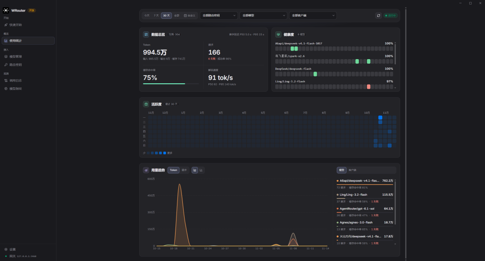

# WROUTER

**本地 AI 网关，为 Claude Code、Codex、OpenCode 等客户端提供统一入口。** 一个本地端点接多家供应商，带路由、故障切换与用量统计，数据全部留在你自己的机器上。

[](LICENSE)
[](#系统要求)
[](https://github.com/iwudun/WRouter/releases)

[English](README.md) | **简体中文**

[下载安装](#下载安装) · [快速开始](#快速开始) · [功能](#功能) · [常见问题](#常见问题) · [文档](#文档)

---

## 为什么需要它

每个编码客户端只说一种协议，配置也各存各的格式。两个客户端配三家供应商，最后会得到四份互相漂移的配置文件；花了多少钱看不到，便宜渠道到底跑的是不是那个模型也不知道。

WRouter 坐在客户端和上游之间：一个本地端点说 OpenAI、Anthropic、Gemini 三种协议，按请求路由、在供应商之间自动切换，并把真实发生的事记下来。

- **一个端点，三种协议** —— `/v1/chat/completions`、`/v1/messages`、`/v1/responses`、`/v1/embeddings`、`/v1beta/models/{action}`。
- **看得见的路由** —— 模型分组、优先级与粘性选择、自动故障切换，每次决策都写进调用日志。
- **供应商管理** —— 界面里增删、探测、切换；API Key 存在 SQLite，接口只返回脱敏值。
- **算得清的用量** —— Token 总量、解码/输出速度、逐模型健康度、相对基线的成本节省。
- **本地优先** —— 无账号、无遥测、无云端；网关只监听回环地址。
- **两种形态** —— Windows 桌面壳（Tauri v2，安装包约 15MB），或 Linux 纯后端（musl 静态二进制 + systemd 用户单元）。

## 截图



<sub>使用统计 —— Token 总量、逐模型健康度、活跃度热力图与成本趋势。</sub>

## 下载安装

### 系统要求

| 平台 | 形态 | 说明 |
| --- | --- | --- |
| Windows 10+ | 桌面壳（Tauri v2） | NSIS 安装包，需要 WebView2（Win 11 自带，Win 10 自动安装） |
| Linux x86_64 | 纯后端 | RPM，glibc 2.28+ 基线，systemd 用户单元，无 GUI 依赖 |
| macOS | **不支持** | 桌面壳只做 Windows，也没有 macOS 构建与测试 |

### Windows

从 [Releases](https://github.com/iwudun/WRouter/releases) 下载 `WRouter_<版本>_x64-setup.exe` 安装。安装包未签名，SmartScreen 可能要求确认。

数据在 `%APPDATA%\WRouter\data`，卸载时保留。

### Linux

```bash
sudo rpm -i WRouter-<版本>.x86_64.rpm
systemctl --user enable --now wrouter
```

然后用浏览器打开 `http://127.0.0.1:3462/`。数据在 `~/.wrouter/`。

## 快速开始

1. **打开管理界面** —— `http://127.0.0.1:3462/`（Windows 由桌面壳拉起）。
2. **添加供应商** —— 供应商 → 新建：填写 base URL、API Key、模型列表；保存前可先点「探测」确认连通性。
3. **把客户端指向网关。**

   ```bash
   # Claude Code
   export ANTHROPIC_BASE_URL=http://127.0.0.1:3460

   # Codex / 任意 OpenAI 兼容客户端
   export OPENAI_BASE_URL=http://127.0.0.1:3460/v1
   ```

4. **看效果** —— 使用统计看 Token 与成本节省，调用日志看每个请求走了哪条路由。

端口：网关 `3460`，管理面 `3462`；可用 `WROUTER_GATEWAY_PORT` / `WROUTER_WEB_PORT` 覆盖。

## 功能

### 路由与供应商

- **模型分组** —— 一个模型名后面挂多家供应商，支持优先级、粘性选择，遇 5xx、超时或空流自动切换。
- **协议转换** —— OpenAI ⇄ Anthropic ⇄ Gemini，覆盖流式、工具调用与思考块。
- **连通性探测** —— 五重判定，区分「密钥失效」「端点被拦」「模型不存在」。
- **客户端指纹预设** —— 可选的头与请求体形态，让按客户端身份设卡的渠道放行。

### 可观测性

- **调用日志** —— 协议、供应商、模型、状态、延迟、Token 账目、切换链路。
- **用量与成本** —— 按日分桶，解码/输出速度分列，相对可配置基线的节省、活跃度热力图。
- **逐模型健康度** —— 每个供应商/模型的成功率与延迟，渠道退化能在你察觉之前暴露出来。

### 模型指纹（可选）

- 用固定的随机数挑战探测供应商，把响应分布与你自建的库比对。
- 适合买了便宜渠道、想确认「是不是真的那个模型」的场景；只用官方直连可以完全不用。

### 安全与数据

- **只监听回环** —— 网关绑定 `127.0.0.1`。
- **密钥不出本机** —— SQLite `secrets` 表，接口一律返回脱敏值；写入三态：空串/缺失/`***` 不动密钥，显式 `null` 才清空。
- **管理面鉴权** —— 请求头 `x-wrouter-web-auth`，token 在 `<数据目录>/auth_token`；`/api/v1/health` 与 `/api/v1/capabilities` 免认证。
- **升级前先备份** —— 只支持最新数据格式：旧配置键不再读取，SQLite 行不做迁移。

## 从源码构建

需要 Node.js ≥ 20（推荐 22）与 Rust 1.98（`backend/rust-toolchain.toml` 锁定）。Windows 还需要 VS Build Tools 2022 + `x86_64-pc-windows-msvc`，以及 WinLibs MinGW（GNU 宿主的后端 workspace 链接用）；Docker 只在打 Linux 包时需要。

```bash
npm run setup     # 安装依赖并构建后端二进制（幂等）
npm run dev       # Vite dev server + Tauri 桌面壳
npm run build:win # Windows 安装包（NSIS）
npm run build:rpm # Linux RPM，在 Docker 内构建
```

质量门：

```bash
bash scripts/check-rust.sh              # 纯度 + fmt + clippy + 测试
cd frontend && npm run typecheck && npm test
node scripts/validate-capabilities.mjs  # 管理面 RPC 契约
npm run version:check                   # 版本号一致性
```

`cargo fmt --check`、`cargo clippy -D warnings`、`typecheck:unused` 在 `master` 上本来就有既有告警：按「本次是否新增」判定，不要全仓格式化。细见 [docs/reference/05](docs/reference/05-开发指南.md)。

## 文档

- [01 项目概览](docs/reference/01-项目概览.md) · [02 架构设计](docs/reference/02-架构设计.md) · [03 网关协议与路由](docs/reference/03-网关协议与路由.md) · [04 功能与兼容性](docs/reference/04-功能与兼容性.md) · [05 开发指南](docs/reference/05-开发指南.md) · [06 构建与发布](docs/reference/06-构建与发布.md) · [07 FAQ 与已知限制](docs/reference/07-FAQ与已知限制.md)
- `docs/design/` —— 模块技术设计
- `docs/LESSONS.md` —— 踩过的坑与结论

## 常见问题

**会上传数据吗？**
不会。网关只监听回环，写本地 SQLite，没有遥测，也没有账号系统。

**怎么升级？**
从 [Releases](https://github.com/iwudun/WRouter/releases) 下载新安装包重装即可，不接自动更新通道。数据在 `%APPDATA%\WRouter\data`（Windows）或 `~/.wrouter/`（Linux），升级后保留且不做迁移 —— 但仍建议先备份，因为只支持最新数据格式。

**支持 macOS 吗？**
暂不支持。桌面壳只做 Windows，Linux 以纯后端形态交付。

## 贡献

欢迎提 issue。PR 需要先开 issue 对齐方向，且只接受小修复（文档、依赖、兼容性）。提交必须带 DCO 签名（`git commit -s`）。

见 [CONTRIBUTING.md](CONTRIBUTING.md) · [SECURITY.md](SECURITY.md) · [CODE_OF_CONDUCT.md](CODE_OF_CONDUCT.md)。

## 许可

MIT © 2026 iwudun。第三方声明见 [THIRD_PARTY_NOTICES.md](THIRD_PARTY_NOTICES.md)。
